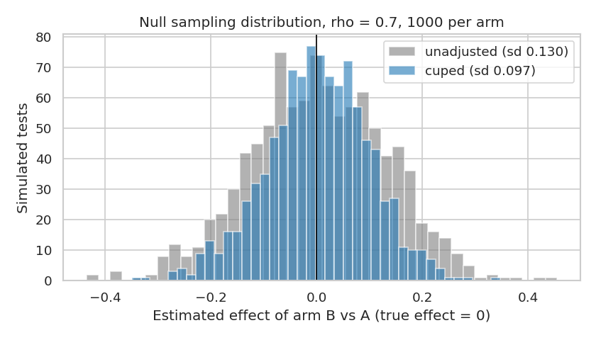
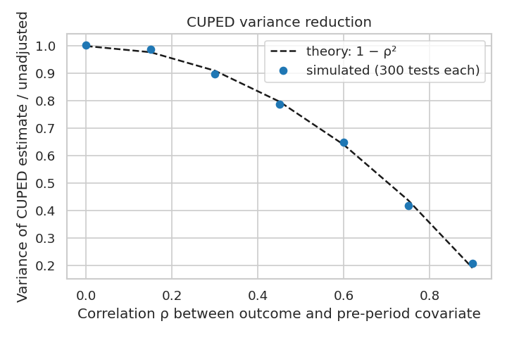
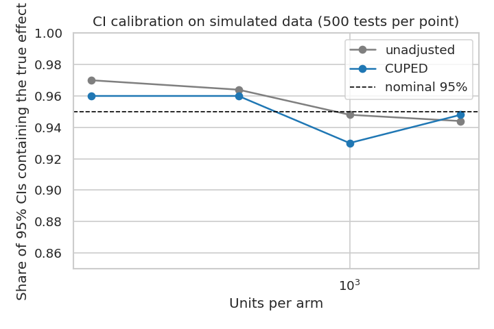

# Dynamic Pricing: Price A/B Readout (CUPED)

**Question.** Does a price change produce the expected revenue change in a randomised test?

**Status: blocked on data.** This repo contains the readout method, its guardrails, tests, and a notebook skeleton. No real randomised price test has been found. None of the three candidate datasets in the plan has arm assignment (see [data/README.md](data/README.md)). No effect has been estimated, and no result is reported.

This is project 3 of the dynamic pricing portfolio. It follows [dynamic-pricing-elasticity](https://github.com/Patotricks15/dynamic-pricing-elasticity) and [dynamic-pricing-optimal-price](https://github.com/Patotricks15/dynamic-pricing-optimal-price).

## Method

Estimand: `ΔR = E[R | arm B] − E[R | arm A]`, where `R` is revenue per unit of randomisation.

- **Unadjusted.** Welch difference in means, with a t-based 95% CI.
- **CUPED.** `Y' = Y − θ(X − E[X])`, with `θ = Cov(Y, X) / Var(X)` and `X` a pre-experiment covariate. It is used only when the covariate is measured before the test starts.
- **Guardrails.** A result is reported only if the arms reach a minimum size, there is no sample ratio mismatch (chi-square, α = 0.001), and the covariate is pre-period.
- **Cross-check.** OLS with HC3 errors and a cross-validated R² for the covariate (seed 42).

## Decision supported

Whether a planned price change is expected to raise revenue per unit, and whether the CI excludes zero. If the CI includes zero, the test does not support the change.

## Limitation

**No randomised price data is available here, so the readout has not been applied to any real test.** The notebook will run only once a real experiment log is attached in a Kaggle Notebook. Until then, these are code and tests only. The candidate datasets are observational or synthetic, so they cannot support a causal price claim.

## Key charts

These charts check the estimators on **simulated data with a known truth** (seed 42). They show the method behaves as expected. They are **not** a price-test result, and no effect is estimated.



*Null sampling distribution of the estimated effect when the true effect is 0 (1000 simulated tests, 1000 units per arm, ρ = 0.7).* CUPED is tighter than the unadjusted estimate (sd 0.097 against 0.130), so the same test gives a narrower CI.



*Variance of the CUPED estimate relative to the unadjusted one, against the correlation ρ with the pre-period covariate.* The simulated ratio follows the theoretical 1 − ρ², so the gain depends on how well the pre-period covariate predicts revenue. A weak covariate gives little gain.



*Share of 95% CIs that contain the known effect (0.2), by units per arm (500 tests per point, ρ = 0.7).* Coverage stays between about 0.93 and 0.97 at every size, so the nominal 95% intervals are roughly calibrated. The gap from 0.95 is within Monte Carlo error for 500 tests.

## Reproduce

Nothing is downloaded. Data is read in place from `/kaggle/input/<slug>/` inside a Kaggle Notebook.

```bash
python -m venv .venv && . .venv/bin/activate
pip install -e ".[dev]"
pytest
```

`notebooks/ab_readout.py` is the source (jupytext percent format), and `notebooks/ab_readout.ipynb` is its conversion with outputs. Section 0 (simulated method checks) runs locally and writes the `sim_*.png` charts to `reports/figures/`. The real-data sections stop with a clear `FileNotFoundError` until the dataset slug is set and the file is attached in a Kaggle Notebook.

## Layout

```
src/dp_abtest/readout.py      difference_in_means, cuped_theta, cuped_adjust, readout
src/dp_abtest/guardrails.py   sample_ratio_mismatch, check_guardrails, pre_period_only
tests/test_readout.py         hand-computed Welch CI, CUPED algebra, variance reduction, guardrails
notebooks/ab_readout.py       readout skeleton that reads /kaggle/input (jupytext percent format)
notebooks/ab_readout.ipynb    unexecuted notebook
reports/figures/              sim_*.png (simulated method checks); arm_revenue_ci.png once run on real data
data/README.md                candidate review, expected input schema, publication rule
```
